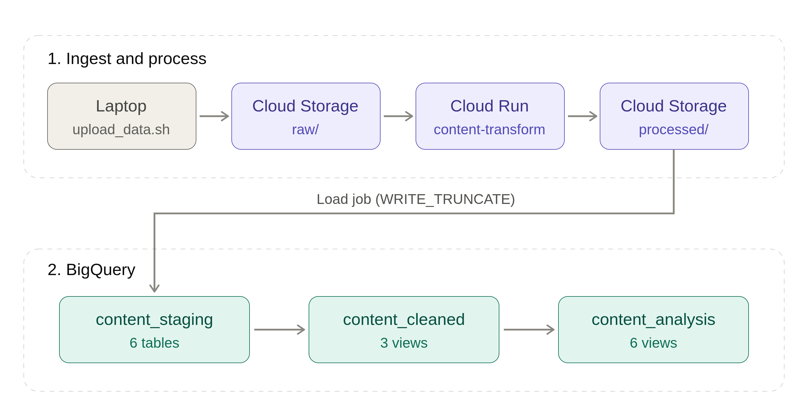

# GCP content intelligence platform: implementation

This repository rebuilds a local Docker and Jupyter project, the [Wix Content Intelligence Pipeline](https://github.com/beatanemeth/Wix-Content-Intelligence-Pipeline), as a **cloud data pipeline on GCP**. The pipeline is a **standalone Terraform module** that a company's existing GCP platform can add without changes. The focus is **Data Engineering**.

Every design decision lives in the [planning repository](https://github.com/beatanemeth/gcp-content-intelligence-platform_planning); this repository implements it.

> **Authorship note:** Planned by me, implemented with Claude Code. Content by me, wording by Claude.

> **Simulated, then run once on real GCP:** every check runs on the laptop, and every simulated result is labelled as simulated ([tests/README.md](tests/README.md)).

> **Real run:** the details in the [runbook](docs/runbook.md); the steps at a glance in the [diagram](assets/deployment_steps.png); the Console in [screenshots](assets/real-run/); the terminal output in [logs](docs/real-run/).

<br>

## The story

- **Part A (the platform):** a company already runs a shared GCP platform with the project, billing, the enabled APIs and the Terraform state bucket.
- **Part B (the feature):** the content pipeline is a new feature on that platform, delivered as a standalone Terraform module.
- **Ownership rule:** a resource that a second feature would need belongs to Part A; everything else belongs to Part B, which changes nothing in Part A.

The main decisions, with their reasons and costs, are in [docs/decisions.md](docs/decisions.md).

<br>

## How it works



| Stage          | Service                     | What happens                                                                               |
| -------------- | --------------------------- | ------------------------------------------------------------------------------------------ |
| **Upload**     | Upload script (laptop)      | The export files go to the data bucket, `raw/<group>/`; a `_READY` marker last             |
| **Processing** | Cloud Run function          | Started by the marker; removes the Wix wrapper, cleans HTML, writes NDJSON to `processed/` |
| **Staging**    | BigQuery `content_staging`  | 6 tables, loaded 1:1 from `processed/` with strict schemas                                 |
| **Cleaning**   | BigQuery `content_cleaned`  | 3 views: names joined in, one row per post or article                                      |
| **Analysis**   | BigQuery `content_analysis` | 4 views: one answer per content question                                                   |

---

<br>

- **The upload script:** `scripts/upload_data.sh` uploads each group's files, then its marker. It changes the cloud, so it never runs here.
- **2 meanings of "raw":** on the laptop, `data/dummy/` (made-up, committed) and `data/raw/` (the real exports, git-ignored); in the data bucket, `raw/` (the uploads) and `processed/` (the function's NDJSON).
- **The 4 questions:** one analysis view each; the list is in the [module README](terraform/modules/content_pipeline/README.md#analysis-views-the-4-questions).

<br>

## Real GCP run

**Real GCP, 2026-10-20:** the module deployed to a personal GCP project, ran on the dummy data and the full dataset, and was destroyed.

| Check                             | Result (real GCP)                                                                 |
| --------------------------------- | --------------------------------------------------------------------------------- |
| `terraform apply`                 | 31 resources; no drift on the second `plan`                                       |
| Upload, function, BigQuery        | Records = rows for all 6 files; dummy and full dataset                            |
| Data checks (`data_checks.sql`)   | Full dataset: 113, 9, 17, 8, 18, 8 rows; no duplicates, orphans or missing titles |
| Analysis views vs. the simulation | The same numbers in all 4 views                                                   |
| `terraform destroy`               | 31 destroyed; Part A untouched                                                    |

- **3 findings:** a bug in the Part A stand-in script, a Google-side permission delay and 2 output-format differences; none in the module. Details: [tests/README.md](tests/README.md#what-the-real-run-confirmed).
- **Cost:** covered by the Free Trial credit.

<br>

## Repository layout

In production this would be four repositories; here they are folders of one:

| Repository in production | Folder here                           | Holds                                                       |
| ------------------------ | ------------------------------------- | ----------------------------------------------------------- |
| **Python code**          | `function/`, `tests/function/`        | The function that unwraps and cleans the exports; its tests |
| **Terraform module**     | `terraform/modules/content_pipeline/` | Part B: buckets, BigQuery, service accounts, the function   |
| **Terraform caller**     | `terraform/environments/dev/`         | One environment: provider, state backend, the module call   |
| **Docs**                 | `docs/`                               | Decisions, the real-GCP runbook, the build log              |

---

<br>

The other folders support all four:

- `scripts/` (upload, data checks, Part A stand-in),
- `tests/simulation/` (BigQuery emulator checks),
- `data/dummy/`, `assets/` and
- `.github/workflows/`.

<br>

```text
.
├── .claude/                        # Claude Code rules, skills and settings
├── .github/workflows/              # offline CI: Terraform, Python, shell
├── assets/                         # the pipeline and deployment diagrams; real-run/: Console screenshots
├── data/dummy/                     # made-up exports; the real ones stay off the repository
├── docs/
│   ├── decisions.md                # design decisions, their reasons and costs
│   ├── runbook.md                  # real GCP deployment, run on 2026-10-20
│   ├── real-run/                   # the run's terminal output
│   └── for_AI/progress.md          # build log and deviations from the plan
├── function/                       # Python code: main.py, requirements.txt
├── scripts/                        # bootstrap.sh (Part A stand-in), upload_data.sh, data_checks.sql
├── terraform/
│   ├── environments/dev/           # Terraform caller: provider, backend, module block
│   └── modules/content_pipeline/   # Terraform module (Part B)
│       ├── *.tf, README.md         # main, storage, bigquery, iam, function; inputs and outputs
│       ├── schemas/                # one JSON schema per staging table
│       ├── templates/              # cleaned/ and analysis/ view SQL
│       └── tests/                  # *.tftest.hcl, mocked Google provider
├── tests/
│   ├── README.md                   # what the simulation proves and where it stops
│   ├── function/                   # pytest with fake cloud clients
│   └── simulation/                 # BigQuery emulator checks
├── CLAUDE.md                       # project guide for Claude Code
├── pyproject.toml                  # pytest and Ruff settings
├── requirements-dev.txt            # local and CI tools
├── .pre-commit-config.yaml, .tflint.hcl, .gitignore
└── README.md
```

<br>

## Main technologies used

- **Infrastructure as code:** Terraform with the Google provider
- **Cloud services (simulated, then run once on real GCP):** Cloud Storage, Cloud Run functions, Eventarc, BigQuery, IAM
- **Processing:** Python 3.14, Beautiful Soup, Functions Framework
- **Quality:** pytest, Ruff, TFLint, ShellCheck, pre-commit
- **Simulation:** a mocked Google provider for `terraform test`; a local BigQuery emulator in Docker
- **CI:** GitHub Actions, offline checks only

<br>

## Run it yourself

All commands run on the laptop and need no GCP credentials. Run them from the repository root unless noted.

### Prerequisites

- **Terraform** 1.16.5
- **TFLint** 0.64.0
- **Docker:** runs the BigQuery emulator for the simulated staging and view checks
- **Python** 3.10 or newer (CI and the function use 3.14)
- **No GCP account:** nothing in this repository needs credentials

### Operating system used

- Linux Mint 21.2

### Set-up

```bash
python3 -m venv .venv
source .venv/bin/activate
python -m pip install --upgrade pip
pip install -r requirements-dev.txt
pre-commit install                            # runs the checks at every git commit
tflint --init --config "$(pwd)/.tflint.hcl"   # installs the pinned TFLint plugins
```

### Terraform checks

```bash
terraform fmt -check -recursive terraform

cd terraform/environments/dev
terraform init -backend=false   # no state bucket, no login
terraform validate              # also validates the module it calls

cd ../../modules/content_pipeline
terraform init -backend=false
terraform test                  # simulated: mocked Google provider

cd ../../..
tflint --recursive --config "$(pwd)/.tflint.hcl"
```

- **`terraform test`:** creates the 2 buckets, the 3 BigQuery datasets, the 6 staging tables, the 3 cleaned views, the 4 analysis views, the 3 service accounts and their 8 grants, and the function with its trigger against a mocked provider, checks their names, settings and scopes, then destroys them. Expected: `6 passed, 0 failed`.
- **`pre-commit run --all-files`:** runs the general file checks, the Terraform hooks (`fmt`, `validate`, TFLint), the Ruff hooks and ShellCheck in one go.

### Python checks

```bash
pytest                # the cleaning and the entry point on the dummy data
ruff check            # lint
ruff format --check   # format

# The cleaning on the laptop: writes 6 NDJSON files to the git-ignored .build/
python function/main.py data/dummy .build/ndjson
wc -l .build/ndjson/*/*.ndjson
```

- **`pytest`:** unwraps and cleans the 6 dummy exports, then checks every cleaned record against its staging schema. Runs `handle_event` on fake upload events with fake Storage and BigQuery clients (simulated). Expected: `39 passed`.
- **The command line:** expected line counts 75, 6, 11, 5, 12 and 5. A second run gives the same files.

### Staging checks (simulated)

Loads the 6 NDJSON files into a local BigQuery emulator, then runs the data checks. Needs Docker and the NDJSON files from the Python checks.

```bash
# Terminal 1: the emulator, with the content_staging dataset; stop it with Ctrl+C
docker run --rm -p 9050:9050 ghcr.io/goccy/bigquery-emulator:0.8.1 \
    --project=content-demo-sim --dataset=content_staging

# Terminal 2
python tests/simulation/check_staging.py
```

### View checks (simulated)

```bash
# Terminal 2, after check_staging.py
python tests/simulation/check_views.py
python tests/simulation/check_views.py --results .build/results-simulated   # also writes each analysis view as CSV
```

The checks and their expected values: [tests/README.md](tests/README.md).
